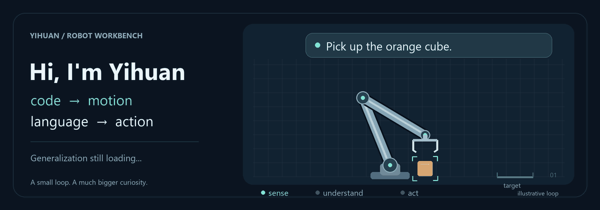

<picture>
  <source media="(prefers-reduced-motion: reduce)" srcset="./assets/robot-workbench.png">
  
</picture>

Robotics undergrad at **Chongqing University**. I make code move things in the real world — then figure out why they moved *that* way.

Currently exploring **robot learning, generalizable manipulation, and VLA**. I'd like robots to handle unfamiliar objects and everyday mess with fewer surprises.

### On the workbench

- 🦾 [arm-platform](https://github.com/yihuanghuan/arm-platform) — ROS 2 control for real robot arms, from commands to motors.
- 👁️ [D435i_Apriltag](https://github.com/yihuanghuan/D435i_Apriltag) — RealSense + AprilTag pose estimation. Coordinate frames included.
- 💬 [LATE-Swarm](https://github.com/yihuanghuan/LLM-UAVswarm-performance) — Connecting language intent with state-aware robot execution.

**Toolbox:** C++ · Python · ROS 2 · PyTorch · OpenCV · Linux  
**Away from the arm:** PX4 · Gazebo · STM32 · MATLAB

<details>
<summary>Debugging reality…</summary>

```text
[OK]   sensors online
[TODO] check coordinate frames. again.
[WIP]  generalization loading…
```

Simulation says yes. Hardware requests a meeting.

</details>
