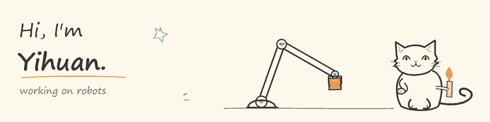

<picture>
  <source media="(prefers-reduced-motion: reduce) and (prefers-color-scheme: dark)" srcset="./assets/doodle-dark.png">
  <source media="(prefers-reduced-motion: reduce)" srcset="./assets/doodle.png">
  <source media="(prefers-color-scheme: dark)" srcset="./assets/doodle-dark.gif">
  
</picture>

I'm Yihuan (黄翊桓), a robotics student at Chongqing University.

These days I'm interested in VLA and robot manipulation, especially how to get a robot to handle an object it hasn't seen before. My repos are a mix of robot-arm control, camera experiments, and earlier work with UAVs.

A few places to start:

- [arm-platform](https://github.com/yihuanghuan/arm-platform): the bits between ROS 2 commands and real motors.
- [D435i_Apriltag](https://github.com/yihuanghuan/D435i_Apriltag): a camera, some tags, and a lot of coordinate frames.
- [LATE-Swarm](https://github.com/yihuanghuan/LLM-UAVswarm-performance): getting language instructions to work with the robots' actual state.

Usually somewhere between C++, Python, ROS 2, and a robot that needs calibrating.

### What's happening in my repos

<!-- REPO-PULSE:START -->
12 public projects · 14 received stars

Tracking starts today.

| Project | Stars |
| :-- | --: |
| [arm-platform](https://github.com/yihuanghuan/arm-platform) | 0 |
| [camera experiments](https://github.com/yihuanghuan/D435i_Apriltag) | 1 |
| [LATE-Swarm](https://github.com/yihuanghuan/LLM-UAVswarm-performance) | 2 |
| [formation &amp; obstacle avoidance](https://github.com/yihuanghuan/Distributed-Multi-UAV-Formation-and-Obstacle-Avoidance-System) | 2 |

Latest releases

- [formation &amp; obstacle avoidance / v2.1](https://github.com/yihuanghuan/Distributed-Multi-UAV-Formation-and-Obstacle-Avoidance-System/releases/tag/v2.1) · 2026-05-09
- [formation &amp; obstacle avoidance / v1.2](https://github.com/yihuanghuan/Distributed-Multi-UAV-Formation-and-Obstacle-Avoidance-System/releases/tag/v1.2) · 2026-05-06
- [formation &amp; obstacle avoidance / v1.1](https://github.com/yihuanghuan/Distributed-Multi-UAV-Formation-and-Obstacle-Avoidance-System/releases/tag/v1.1) · 2026-04-26
- [formation &amp; obstacle avoidance / v1.0](https://github.com/yihuanghuan/Distributed-Multi-UAV-Formation-and-Obstacle-Avoidance-System/releases/tag/v1.0) · 2026-04-25

Updated 2026-10-11 08:20 UTC · daily checks
<!-- REPO-PULSE:END -->

### Feeding the commit snake

<picture>
  <source media="(prefers-color-scheme: dark)" srcset="./assets/contribution-snake-dark.svg">
  
</picture>

Made from my contribution calendar with <a href="https://github.com/Platane/snk">snk</a>. It gets fed daily.

A note on the cat

The robot was told to pick up the block. The cat wasn't told anything.

